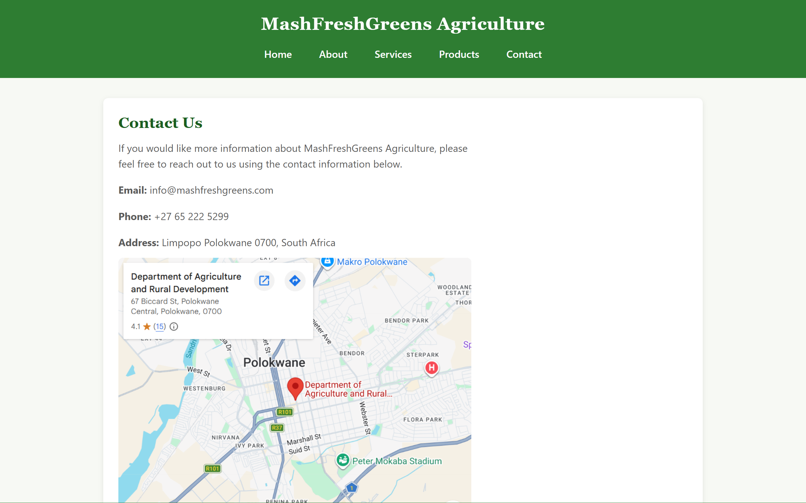
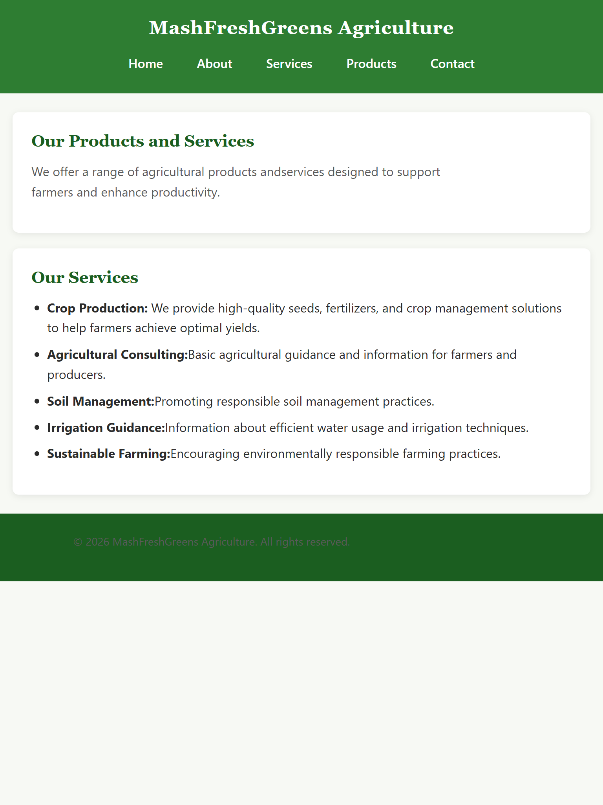
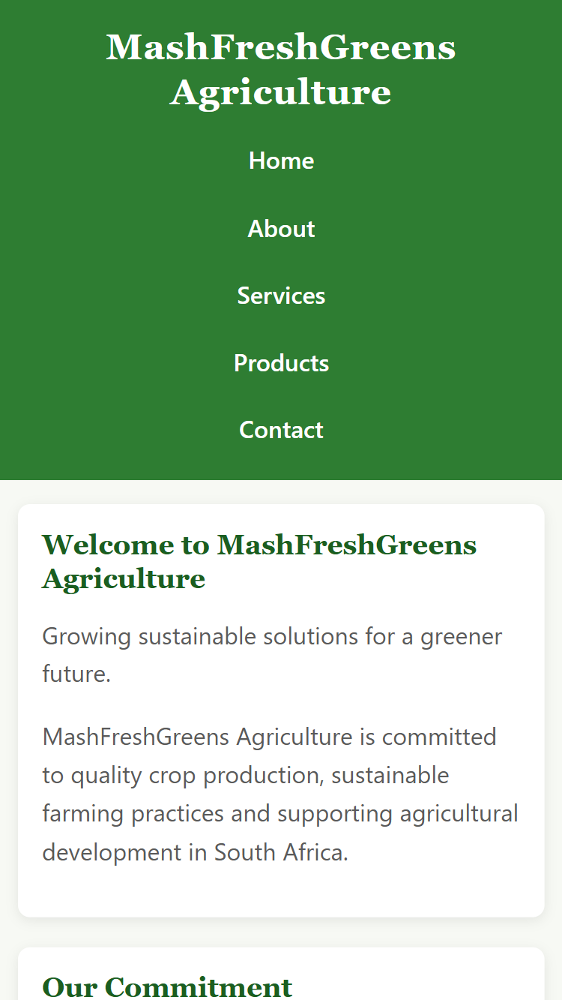

# MashFreshGreens Agriculture Website

## Project Description

MashFreshGreens Agriculture is a hypothetical South African agricultural
organisation focused on crop production, sustainable farming and
agricultural services.

The website provides information about the organisation, its products
and services, product images and contact information.

## Website Pages

The website consists of the following pages:

- Home
- About Us
- Services
- Products
- Contact

## Technologies Used

- HTML5
- CSS3 (Flexbox, Grid, media queries, custom properties)
- JavaScript (vanilla JS — DOM manipulation, form validation, AJAX via `fetch()`)
- [Leaflet.js](https://leafletjs.com/) + OpenStreetMap (interactive map)
- [Formspree](https://formspree.io/) (form backend / email delivery)
- Git
- GitHub

## Form Setup (Formspree)

Both `contact.html` and `enquiry.html` submit via AJAX to
[Formspree](https://formspree.io), a free third-party service that emails
the form contents without needing a custom backend server.

How it was set up:

1. Created a free account at [formspree.io](https://formspree.io).
2. Created a new form, which gave the endpoint
   `https://formspree.io/f/mwllwpwa`.
3. Set that endpoint as the `action` of the form in `contact.html` and
   `enquiry.html`.
4. Submitted each form once and confirmed the email in the Formspree
   dashboard (the first submission requires a one-time confirmation).

`js/script.js` handles the client-side validation and AJAX submission
using `fetch()`, so the page does not reload when a form is sent.

## Deployment

The site is static (no server-side code), so it can be hosted on any
static host.

- **Netlify (recommended):** go to
  [app.netlify.com/drop](https://app.netlify.com/drop) and drag the
  project folder onto the page for an instant live URL.
- **GitHub Pages:** repository Settings → Pages → deploy from the `main`
  branch, root folder.

Live site link: **[https://vocal-pony-4645d3.netlify.app]**

## Target Audience

The website is aimed at:

- Farmers
- Agricultural students
- Consumers
- Agricultural businesses
- Members of the public interested in agriculture

## Website Goals

The main goals of the website are to:

1. Introduce MashFreshGreens Agriculture.
2. Provide information about its services.
3. Showcase agricultural activities.
4. Provide contact information.
5. Promote sustainable agriculture.

## Project Structure

```text
MashFreshGreens-Website/
├── index.html
├── about.html
├── services.html
├── products.html
├── enquiry.html
├── contact.html
├── css/
│   └── style.css
├── js/
│   └── script.js
├── images/
├── screenshots/
├── robots.txt
├── sitemap.xml
└── README.md
```

## GitHub Repository 

Repository Link: https://github.com/emmisstos44-boop/MashFreshGreens-Agriculture-Website.git

## Wireframes

Low-fedility wireframes are sketched to plan the structure of each page (header, nav, content sections, footer).

### Home

```text
┌─────────────────────────────────────┐
│      MashFreshGreens Agriculture    │
│  [Home][About][Services][Products]  │
│              [Contact]              │
├─────────────────────────────────────┤
│  Welcome to MashFreshGreens         │
│  paragraph text...                  │
├─────────────────────────────────────┤
│  Our Commitment                     │
│  paragraph text...                  │
├─────────────────────────────────────┤
│   © 2026 MashFreshGreens Agriculture│
└─────────────────────────────────────┘
```

### About

```text
┌─────────────────────────────────────┐
│           header + nav              │
├─────────────────────────────────────┤
│  About MashFreshGreens              │
├─────────────────────────────────────┤
│  Our Mission                        │
├─────────────────────────────────────┤
│  Our Vision                         │
├─────────────────────────────────────┤
│  Our Values (list)                  │
├─────────────────────────────────────┤
│           footer                    │
└─────────────────────────────────────┘
```

### Services

```text
┌─────────────────────────────────────┐
│           header + nav              │
├─────────────────────────────────────┤
│  Our Products and Services          │
├─────────────────────────────────────┤
│  [ Search services... ]             │
│  ▸ Crop Production      (accordion) │
│  ▸ Agricultural Consulting          │
│  ▸ Soil Management                  │
│  ▸ Irrigation Guidance              │
│  ▸ Sustainable Farming              │
├─────────────────────────────────────┤
│           footer                    │
└─────────────────────────────────────┘
```

### Products

```text
┌─────────────────────────────────────┐
│           header + nav              │
├─────────────────────────────────────┤
│  Our Gallery — intro text           │
├─────────────────────────────────────┤
│  ┌───────────┐   ┌───────────┐      │
│  │  Our Farm │   │ Our Crops │      │
│  └───────────┘   └───────────┘      │
│  ┌───────────┐   ┌───────────┐      │
│  │  Produce  │   │Irrigation │      │
│  └───────────┘   └───────────┘      │
│  (click any image → lightbox popup) │
├─────────────────────────────────────┤
│           footer                    │
└─────────────────────────────────────┘
```
### Enquiry

```text
┌─────────────────────────────────────┐
│           header + nav              │
├─────────────────────────────────────┤
│  Make an Enquiry — intro text       │
├─────────────────────────────────────┤
│  Name / Email / Phone fields        │
│  Reason: [ dropdown: Quote /        │
│            Volunteer / Sponsor ]    │
│  Details: [ textarea ]              │
│  [ Submit Enquiry ]                 │
├─────────────────────────────────────┤
│           footer                    │
└─────────────────────────────────────┘
```

### Contact

```text
┌─────────────────────────────────────┐
│           header + nav              │
├─────────────────────────────────────┤
│  Contact Us — email/phone/address   │
│  [ Interactive Leaflet map ]        │
├─────────────────────────────────────┤
│  Send us a Message                  │
│  Name / Email / Message fields      │
│  [ Send Message ]                   │
├─────────────────────────────────────┤
│           footer                    │
└─────────────────────────────────────┘
```

## Changelog

All the changes made to this project are documented below based on the feedback from part 1.

## Part 1 Inital website foundation

- Created the MashFreshGreen Agriculture website project.
- Created the Home page.
- Created the About Us page.
- Created the Services page.
- Created the Products page.
- Created the Contact page.
- Added navigation between all website pages.
- Added basic website content.
- Added images.
- Added a contact form.
- Added internal and external links.
- Created the CSS folder and external stylesheet.
- Created the images folder.
- Created project documentation.


## Part 1 corrections

- Added Wireframes section to README showing the planned page layout.
- Added GitHub repository link to README.
- Added changelog section to track the project's development
- Fixed broken image folder structure
- Added initial HTML structure for Home, About, Services, Products and Contact page.
- Removed unnecessary inline styling from HTML elements.
- Fixed missing header tag.
- Added project images (`crops.jpg`, `farm.jpg`, `produce.jpg`,
  `irrigation.jpg`).
- Fixed image mismatch.
- Fixed unused section which is removed.
- Added comments for about, contact, index, products and services page
  

## Part 2

- Added base CSS styling.
- Added typography styling.
- Added desktop layout using CSS Grid/Flexbox.
- Added colours, borders, shadows and hover effects.
- Added responsive layouts for desktop, tablet and mobile.
- Added responsive images.
- Fixed: Unclosed `<footer>` tags on `index.html` and `about.html`, missing
  `<header>` wrapper on `products.html`, and a duplicate `</section>` on
  `contact.html`.
- Tested: Verified layout and responsiveness using browser developer tools
  across desktop (1280px), tablet (iPad Mini, ~768px), and mobile
  (iPhone SE, 375px) viewports. Screenshots below.

#### Screenshots

**Desktop — Contact page**


**Tablet (iPad Mini) — Services page**


**Mobile (iPhone SE) — Home page**


## Part 3

- Added a new Enquiry page (`enquiry.html`) with its own form for
  requesting a quote, volunteering, or sponsoring a project — kept
  separate from the general message form on the Contact page.
- Added `js/script.js`, linked from every page, containing:
  - An accordion on the Services page so each service expands/collapses
    on click instead of showing everything at once.
  - A live search box on the Services page that filters the service list
    as the user types.
  - A lightbox on the Products page so clicking a gallery image opens a
    larger view instead of just sitting flat on the page.
  - An interactive Leaflet.js map on the Contact page, replacing the
    static Google Maps embed with a real pannable/zoomable map and a
    marker popup.
  - Client-side form validation (required fields, email format, minimum
    message length) with inline error messages for both forms.
  - AJAX form submission using `fetch()` so both forms submit without
    reloading the page, showing a loading state and a success/error
    message instead.
- Added SEO: unique title and meta description/keywords on every page,
  `robots.txt`, and `sitemap.xml` listing all 6 pages.
- Added internal links between the Contact and Enquiry pages so visitors
  land on whichever form matches what they need.
- Added Form Setup and Deployment sections to this README.
- Fixed: replaced the non-interactive Google Maps iframe with a fully
  interactive map.

## References

- The Independent Institute of Education (Pty) Ltd. (2026). *WEDE5020: Web
  Development (Introduction) Module Guide.*
- Mozilla Developer Network (MDN). *HTML: HyperText Markup Language.*
  https://developer.mozilla.org/en-US/docs/Web/HTML
- Mozilla Developer Network (MDN). *CSS: Cascading Style Sheets.*
  https://developer.mozilla.org/en-US/docs/Web/CSS
- MDN Web Docs (2026) CSS styling basics.*https://developer.mozilla.org/en-US/docs/Learn_web_development/Core/Styling_basics 
- MDN Web Docs (2026) CSS layout.*https://developer.mozilla.org/en-US/docs/Learn_web_development/Core/CSS_layout
- Mozilla Developer Network (MDN). *JavaScript.*
  https://developer.mozilla.org/en-US/docs/Web/JavaScript
- Leaflet. *Leaflet — an open-source JavaScript library for interactive maps.*
  https://leafletjs.com/
- OpenStreetMap contributors. *OpenStreetMap.*
  https://www.openstreetmap.org/copyright
- Formspree. *Formspree — Form backend for static sites.*
  https://formspree.io/
- Google Search Central. *Search Engine Optimization (SEO) Starter Guide.*
  https://developers.google.com/search/docs/fundamentals/seo-starter-guide


